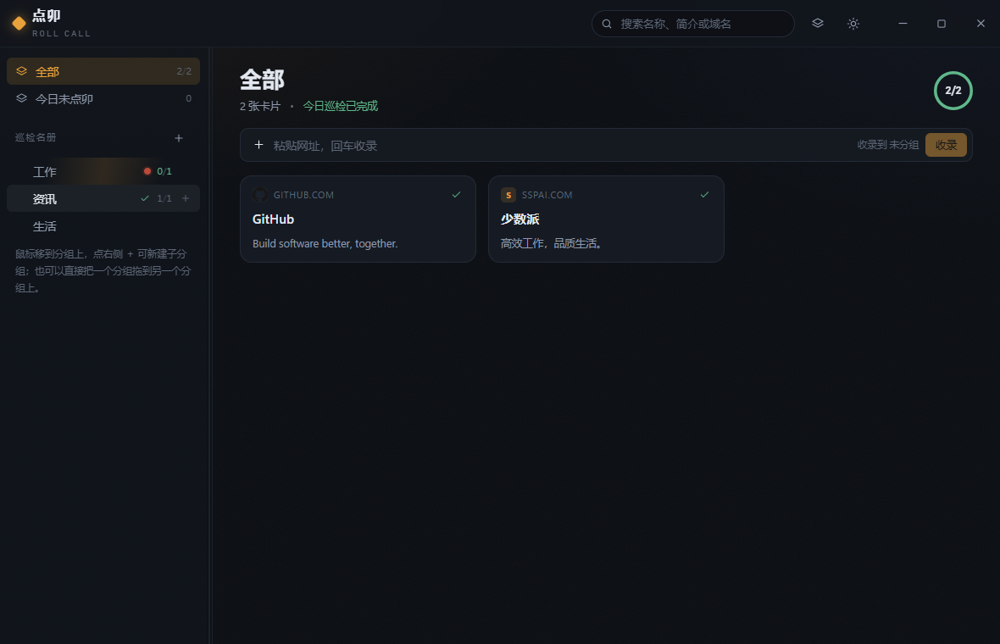
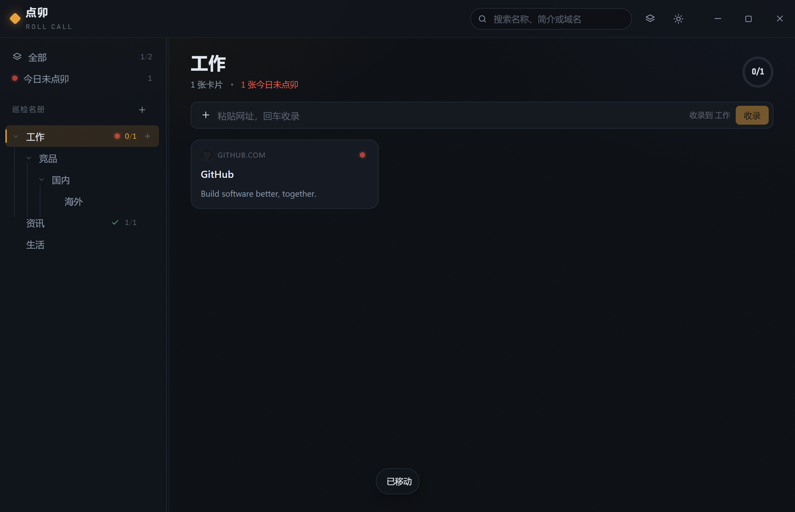
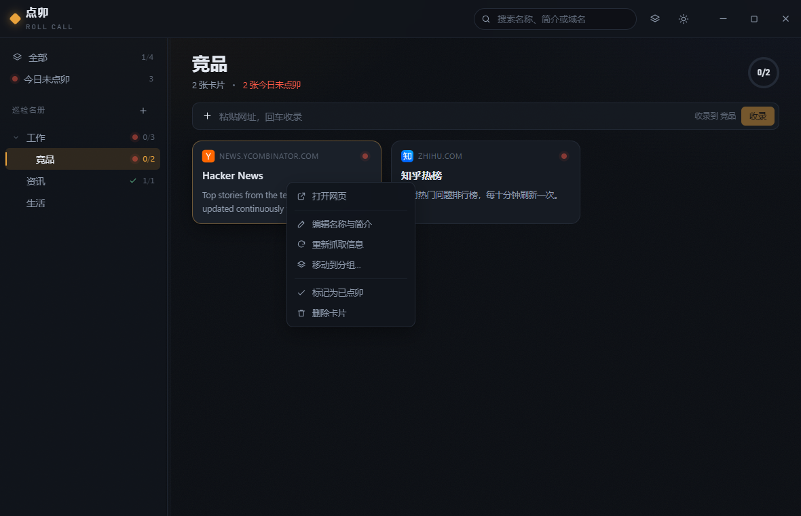
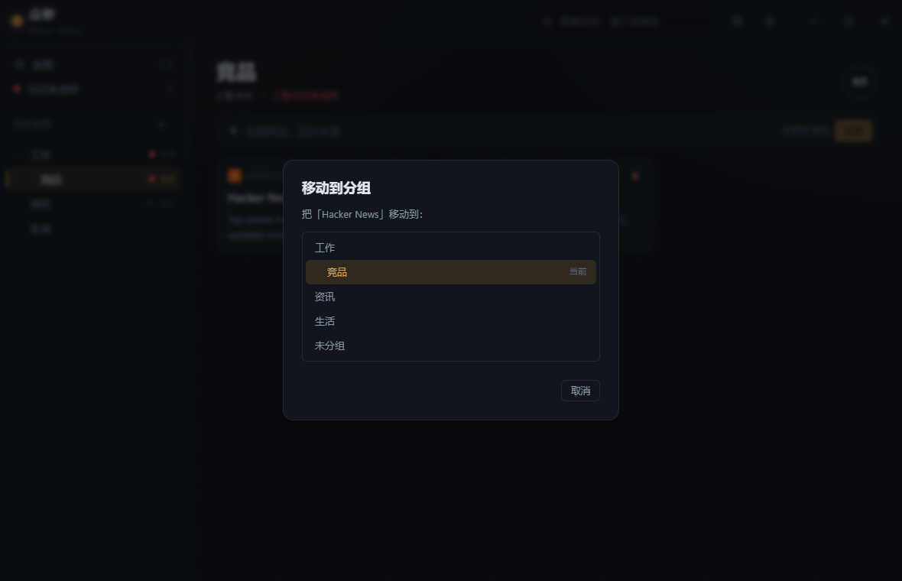

<div align="center">


# 日常新闻 · Daily Information

**把你每天要看的网站收进卡片，用多级文件夹组织；今天没点过的亮红点，点过就熄灭。**

本地优先的 Windows 桌面巡检板 · 不抓文章、不做摘要、不上传任何数据

[](./LICENSE)
[](#快速开始)
[](#技术栈)
[](#技术栈)
[](#技术栈)
[](#开发)
[](#快速开始)
[](#已知限制)

[功能特性](#功能特性) · [截图](#截图) · [快速开始](#快速开始) · [工作原理](#工作原理) · [技术栈](#技术栈) · [开发](#开发) · [文档](#文档)

</div>

---

## 为什么做这个

困扰我的从来不是「内容太多」，而是**收藏夹里躺了几十个网站，却从来不记得去看**。

书签只负责存，不负责提醒；RSS 阅读器回答的是「有新内容吗」，而我想知道的是一件更简单的事——

> 今天，我把该看的网站巡过一遍了吗？

日常新闻只做这一件事：把网站变成卡片，今天没点过的亮红点，点过就熄灭。跨过午夜自动重置，**不需要定时任务，不需要后台常驻进程**。

它刻意不做的事：不抓取文章正文、不做摘要、不判断网站内容有没有更新、不需要账号、不联网同步。

## 截图

<div align="center">

| 全部视图 | 多级分组（验证到四层） |
| :---: | :---: |
|  |  |
| **卡片右键菜单** | **移动到分组** |
|  |  |

</div>

## 功能特性

### 巡检：核心循环

| 功能 | 说明 |
| :--- | :--- |
| **今日红点** | 未点卯的卡片显示信号红脉动圆点，已点卯显示完成色对勾 |
| **点卯即消除** | 点击卡片打开系统浏览器，同时记录当天已巡，红点以涟漪动画消失 |
| **自动重置** | 跨过午夜 00:00 自动回到未点卯，无需任何定时任务 |
| **分组进度** | 每行显示整棵子树的 `已查看 / 总数`，父分组递归聚合 |
| **巡检完成反馈** | 分组进度归零时播放一次琥珀色扫光 |
| **今日未点卯视图** | 一键只看还没巡的卡片 |

### 组织：多级文件夹

| 功能 | 说明 |
| :--- | :--- |
| **不限层级的嵌套分组** | 数据库用自引用 `parent_id`，查询用递归 CTE 穿透任意深度 |
| **悬停即建子分组** | 鼠标移到分组行，行尾出现 ＋，点它就在该分组下新建 |
| **拖拽整理** | 把分组拖到另一个分组上即嵌套，拖到空白处即回到根级 |
| **层级竖线** | 每深一层多一条竖向指引线，层级关系一眼可见 |
| **防环保护** | 把父分组拖进自己的后代会被拒绝并提示 |
| **折叠状态持久化** | 折叠状态写进数据库，重启后保持 |

### 收录：粘贴网址即可

| 功能 | 说明 |
| :--- | :--- |
| **自动抓取元数据** | 粘贴网址即抓取标题、简介、图标、OG 图，无需手动找 RSS |
| **中文编码处理** | 自动识别 GBK / GB18030 / Big5，中文站点不会乱码 |
| **抓取失败不阻断** | 降级为域名展示，卡片照常创建 |
| **手动编辑** | 名称与简介可随时手动修正，这是元数据抓取失败时的逃生口 |
| **重新抓取** | 右键可重新抓取，保留点卯记录 |

### 外观与操作

| 功能 | 说明 |
| :--- | :--- |
| **亮 / 暗主题** | 跟随系统，可手动切换，选择被记忆 |
| **自绘无边框标题栏** | 窗口视觉完全由应用掌控 |
| **搜索过滤** | 按名称 / 简介 / 域名实时过滤 |
| **撤销删除** | 删除卡片后 5 秒内可撤销 |
| **键盘快捷键** | `Ctrl+K` 聚焦搜索，`Ctrl+N` 聚焦添加框，`Esc` 关闭弹层 |
| **单实例保护** | 重复点击图标不会开出第二个窗口，而是把已有窗口提到前台 |
| **无障碍** | 尊重系统「减少动态效果」设置 |

## 快速开始

仓库不附带预编译二进制——安装包与便携版合计约 18 MB，放进 Git 历史会显著拖慢克隆。三条路径任选。

### A. 下载已发布的版本

推送版本标签（如 `v0.1.0`）会触发 [GitHub Actions](./.github/workflows/release.yml) 在 Windows 上自动构建并发布到 [Releases](https://github.com/2214331539/Daily-Information/releases)。

| 形态 | 适用场景 | 数据位置 |
| :--- | :--- | :--- |
| **安装版** `日常新闻_*_x64-setup.exe`（3.8 MB） | 长期使用，要开始菜单入口与正规卸载 | `%APPDATA%\com.dianmao.app\` |
| **便携版** 单 exe（13.9 MB） | 放 U 盘、多机同步、不想在系统里留痕 | exe 同目录的 `data\` |

### B. 本地构建

```bash
git clone git@github.com:2214331539/Daily-Information.git
cd Daily-Information
npm install
npm run build
```

产物：

```
src-tauri/target/release/
├── dianmao.exe                                便携版单文件（即主程序）
└── bundle/nsis/日常新闻_0.1.0_x64-setup.exe    安装包（可选安装路径）
```

### C. 只跑开发模式

```bash
npm run dev      # 首次会完整编译 Rust 依赖，约 3–6 分钟
```

> 便携版需要 `data` 文件夹与 exe 放在一起，整个文件夹拷走即完成迁移。
> 两种形态都未做代码签名，首次运行 Windows SmartScreen 会提示「未知发布者」，点「更多信息 → 仍要运行」即可。

**环境要求**：Rust 1.77+（MSVC 工具链）、Node.js 20+、Visual Studio 生成工具 2022、WebView2 运行时（Win11 与新版 Win10 自带）。

## 工作原理

整个产品的复杂度都压在一条判定规则上：

```sql
未点卯 = last_clicked_at IS NULL
      OR date(last_clicked_at, 'localtime') <> date('now', 'localtime')
```

三个刻意的设计决定：

**1. 按本地时区比较「日期」，不是「24 小时窗口」。**
早上 9 点点过的卡片，当天 23:59 依然是已点卯；跨过午夜 00:00 立刻回到未点卯。如果用滑动窗口，红点会在一天中的随机时刻冒出来，违背「每日巡检」的心智模型；用 UTC 比较则会出现晚上 20:00 之后点击仍显示红点的经典时区 bug。

**2. 不需要定时任务。**
红点是查询时算出来的，不是定时写出来的。关闭应用一周再打开，状态自动是对的。

**3. 内容永远不参与判定。**
网站今天更新没有、更新了几条，都不影响红点。红点只回答一个问题：**我今天点过它没有。**

```
┌──────────────┐    点击卡片    ┌──────────────┐
│  未点卯  ●   │ ────────────▶ │  已点卯  ✓   │
│  红点脉动     │   写入时间戳    │  完成色对勾   │
└──────────────┘               └──────────────┘
        ▲                              │
        └──────────────────────────────┘
               跨过午夜 00:00 自动重置
```

## 使用

### 建立多级分组

| 目的 | 操作 |
| :--- | :--- |
| 新建根级分组 | 侧栏「巡检名册」右侧的 ＋，或在侧栏空白处右键 →「新建分组」 |
| 新建子分组 | **鼠标悬停任意分组行，点行尾出现的 ＋**；或右键该分组 →「新建子分组」 |
| 调整层级 | 把一个分组拖到另一个分组上 |
| 提升到根级 | 把分组拖到侧栏空白处（卡片拖到空白处则移入「未分组」） |

> 新建子分组时父分组会自动展开——否则父级处于折叠状态时用户看不到新分组出现，会误判为功能失效。

### 开始一天的巡检

1. 打开应用，侧栏显示每个分组的进度，例如「工作 · 3/8」
2. 点击分组，右侧卡片网格逐个淡入，未点卯的带红点
3. 点卡片 → 浏览器打开该网站，同时红点收缩消失、进度 +1
4. 进度变成 8/8 时该行播放一次完成扫光

## 技术栈

| 层 | 选型 | 为什么 |
| :--- | :--- | :--- |
| 应用框架 | [Tauri 2](https://github.com/tauri-apps/tauri) | 安装包 3.8 MB、内存约 30 MB，对比 Electron 的百兆级包体；复用系统 WebView2 |
| 前端 | React 19 + TypeScript | 组件模型成熟，类型安全 |
| 构建 | Vite 8 | 热更新快，与 Tauri 官方模板集成 |
| 后端 | Rust | 出站请求与本地数据库都在 Rust 侧，天然规避 CORS |
| 数据库 | SQLite（`rusqlite` bundled） | 单文件、零外部依赖，`bundled` 特性自带 SQLite 源码 |
| 网络 | `reqwest`（rustls） | 用 rustls 避免 OpenSSL 链接问题 |
| HTML 解析 | `scraper` | 基于 html5ever，容错性远好于正则 |
| 编码识别 | `encoding_rs` | 正确处理中文站点的 GBK 系列编码 |
| 样式 | 原生 CSS + CSS 变量 | 不引入 Tailwind，保留对设计细节的完全控制 |

**一个必须知道的约束：所有出站请求都在 Rust 侧发起。** 浏览器环境下的 `fetch()` 受同源策略限制，从 WebView 直接请求第三方网页会被 CORS 拦截。这是本项目唯一会让人卡住的技术点。

## 项目结构

```
Daily-Information/
├── 日常新闻-产品与技术文档.md     唯一的产品 + 技术文档（先读它）
├── docs/                          界面预览与矢量 Logo
├── src/                           前端（React 19 + TypeScript）
│   ├── App.tsx                    应用外壳与状态编排
│   ├── api.ts                     Tauri 命令的类型化封装
│   ├── types.ts                   与 Rust models.rs 一一对应
│   ├── util.ts                    分组树构建与子树聚合
│   ├── icons.tsx                  内联 SVG 图标（不引第三方图标库）
│   ├── components/                标题栏、分组树、卡片、弹窗、提示
│   └── styles/                    设计令牌与组件样式
└── src-tauri/                     后端（Rust）
    ├── tauri.conf.json            窗口、无边框标题栏、打包配置
    ├── capabilities/default.json  最小权限白名单
    └── src/
        ├── lib.rs                 构建器、状态托管、数据目录判定
        ├── db.rs                  SQLite 迁移、查询、防环校验、单元测试
        ├── models.rs              serde 数据契约
        ├── metadata.rs            网页元数据抓取与降级策略
        └── commands.rs            对外命令层
```

## 数据与隐私

**所有数据都在这台电脑上。** 没有账号、没有云端、没有遥测。

| | |
| :--- | :--- |
| 存储 | 单个 SQLite 文件，安装版在 `%APPDATA%\com.dianmao.app\dianmao.db` |
| 出站请求 | 仅两个场景：添加卡片时抓取网页元数据、点击卡片时用系统浏览器打开链接 |
| 上传 | 无。应用不向任何服务器发送你的数据 |
| 备份 | 复制那个 `.db` 文件即可；便携版连文件夹一起拷走 |

## 设计

视觉方向叫「**夜巡**」——深夜值班室的秩序感。

整个界面只有两种颜色承担信息：**琥珀色**代表可操作与进行中，**信号红**代表今天还没做。其余一切退到背景里。信号红被严格限制在「未点卯」状态上，不用于按钮主色或装饰，否则红点会失去信号意义。

字体不引入外部资源，靠排版系统建立辨识度：Bahnschrift 负责展示与数字，Segoe UI Variable 负责正文，计数一律使用等宽表格数字。

动效只服务于三件事——状态变化可见、空间关系明确、点击有反馈。卡片入场按索引错开 28ms，红点以 2.4 秒周期呼吸，点卯瞬间红点收缩并扩散一圈涟漪。系统开启「减少动态效果」时全部关闭。

完整规范见 [产品与技术文档 · 第 8 章](./日常新闻-产品与技术文档.md)。

## 开发

```bash
npm run dev          # Tauri 开发模式（自动拉起 Vite 与 Rust 编译）
npm run build        # 发布构建，产出安装版与便携版
npm run typecheck    # TypeScript 类型检查
npm run web:build    # 只构建前端资源

cd src-tauri
cargo test --lib                            # 15 个单元 / 集成测试
cargo test --lib -- --ignored --nocapture   # 联网测试：真实抓取网页元数据
```

测试覆盖了产品里最容易出错的部分：多级分组的持久化与递归穿透、分组移动防环、级联删除、折叠父分组时新建子分组、点卯的日期语义，以及网页元数据解析与中文编码。

## 打包

`npm run build` 一次产出两种形态：

```
src-tauri/target/release/
├── dianmao.exe                                便携版单文件
└── bundle/nsis/日常新闻_0.1.0_x64-setup.exe    安装包（可选安装路径）
```

安装包使用 NSIS，`installMode: currentUser` 表示按当前用户安装、不需要管理员权限，安装过程中可以自选目录。

## 已知限制

| 限制 | 说明 |
| :--- | :--- |
| 部分站点抓不到元数据 | 需要登录、强反爬或纯 JS 渲染的站点可能只能拿到域名，可用手动编辑兜底 |
| 不做内容变更感知 | 这是产品定位，红点只反映「今天点过没有」 |
| 未做代码签名 | 首次运行会有 SmartScreen 提示，正式分发需购买 OV/EV 证书 |
| CSP 尚未收紧 | 为开发期热更新保持宽松，进入 1.0 前会收紧 |
| 仅支持 Windows | 当前只发布了 Windows 目标 |

## 路线图

- [x] 多级嵌套分组与子树进度聚合
- [x] 网页元数据抓取（含中文编码处理）
- [x] 安装版与便携版双形态打包
- [x] 单实例保护
- [ ] 链接探活，标记已失效的站点
- [ ] 导入浏览器书签
- [ ] 巡检历史与连续天数统计
- [ ] 分组级巡检提醒（系统通知）
- [ ] 数据导出 / 导入与可选的多设备同步

## 文档

**[日常新闻-产品与技术文档.md](./日常新闻-产品与技术文档.md)** 是本项目唯一的产品与技术文档，产品定义、交互规则、视觉规范、数据模型、接口契约、构建方式与验证记录全部收录其中，不再拆分第二份。

它包含四部分：产品文档、技术实现文档、验收清单、验证记录（含每一条结论的复现命令）。

## 贡献

欢迎提交 Issue 与 Pull Request。开始之前请先读一遍产品与技术文档，尤其是第 7 章「交互规则细则」——红点的判定规则有几条不能违反的约束，改动前请先确认理解一致。

```bash
# 提交前请确保
npm run typecheck                    # 前端类型检查通过
cd src-tauri && cargo test --lib     # 后端测试通过
```

## 许可证

[MIT](./LICENSE) © 2026 2214331539
